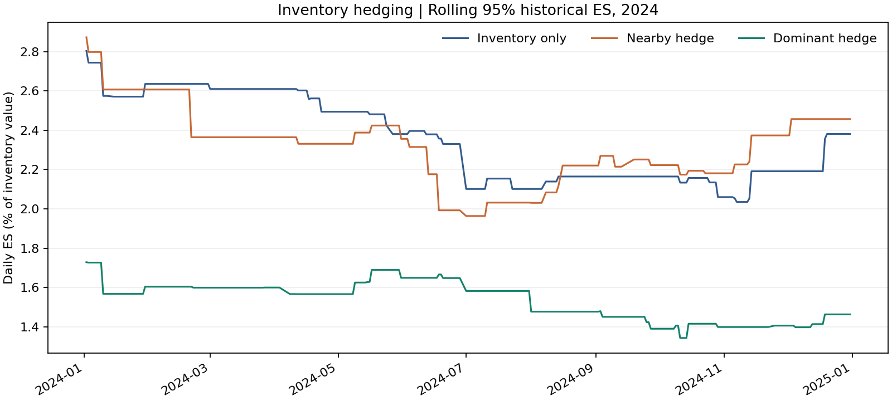

# Soybean oil inventory hedging and tail risk

Does the choice of futures contract change how much a hedge protects inventory on its worst days? Across 231 matched observations in 2024, the dominant-contract hedge had a 95% expected shortfall of **1.49% of inventory value**, compared with **2.43% for unhedged inventory**. A nearby-contract hedge reduced daily volatility slightly, while expected shortfall remained close to the unhedged level.

[Full research report in Chinese (PDF)](reports/soybean-oil-hedging-zh.pdf) · [Annual estimates (CSV)](results/2024/risk_summary.csv)

| Inventory position | Daily volatility | 95% historical VaR | 95% historical ES |
| --- | ---: | ---: | ---: |
| Unhedged | 1.01% | 1.82% | 2.43% |
| Short nearby futures | 0.95% | 1.89% | 2.48% |
| Short dominant futures | 0.68% | 1.13% | 1.49% |

Expected shortfall (ES) averages the 12 largest daily losses for each position. The positions share evaluation dates but can experience their worst losses on different days.



Each point uses the preceding 250 eligible observations. The dominant hedge had lower rolling ES than unhedged inventory on all 231 evaluation dates. The nearby hedge had lower rolling value at risk (VaR) on 190 dates and lower rolling ES on 121. The windows overlap. The annual table uses the 231 evaluation dates as a single sample.

## Measuring the hedge

The classroom exercise asks whether a one-for-one short futures position protects soybean oil inventory from large losses. It defines a price proxy as spot less the current day's futures price change and measures risk using log changes in that proxy. The replication estimates rolling 95% VaR and ES with historical simulation and a peaks-over-threshold model.

The extension records daily inventory and futures profit or loss directly. For each unit of inventory, the hedged return is **(change in spot price − change in futures price) / previous spot price**. Changes are computed before filtering dates. Eleven of 242 dates were excluded because at least one futures identifier changed. The comparison omits roll-day P&L, transaction costs and margin funding. “Dominant” follows the input dataset's contract designation.

## A day when contract choice mattered

On 13 November 2024, the spot price fell 300 units. The nearby quote was unchanged, leaving the nearby hedge with a 3.45% inventory loss. The dominant futures price fell 288 units, so its short position offset most of the inventory loss and the combined position lost 0.14%. The data establish the price changes but do not identify why the nearby quote was unchanged.

Removing each date in turn and recomputing the tail averages left the dominant hedge's ES advantage over unhedged inventory between 0.80 and 1.01 percentage points. The nearby hedge's ES difference ranged from −0.05 to +0.23 points. These ranges measure sensitivity to individual observations. [Deletion results](results/2024/leave_one_out.csv)

## Reproduction

Python 3.12. From the repository root:

```sh
python -m pip install -r requirements.txt
python run_project.py --data "豆油.csv" --year 2024
```

The analysis uses the coursework dataset. The raw CSV is not distributed here. Required columns are 时间 (date), 现货价格 (spot price), 近期合约期货代码 and 近期合约期货价格 (nearby identifier and price), and 主力合约期货代码 and 主力合约期货价格 (dominant identifier and price). Prior-year observations supply the rolling window. The scripts regenerate the classroom figures, inventory comparison, tail dates and sensitivity results in results/2024/.
