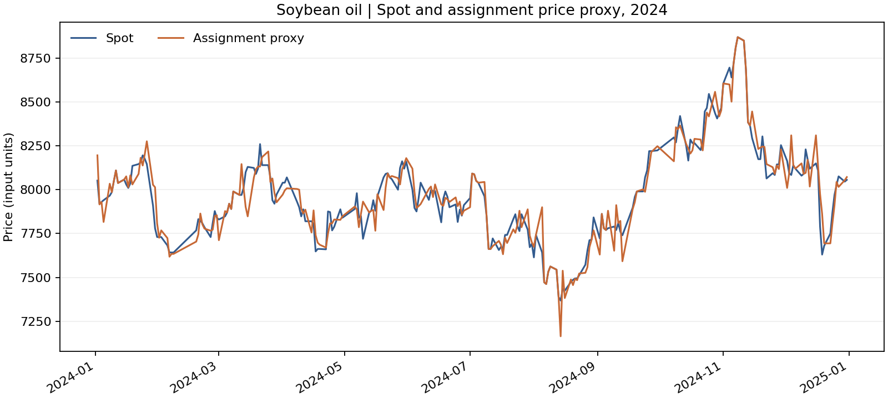
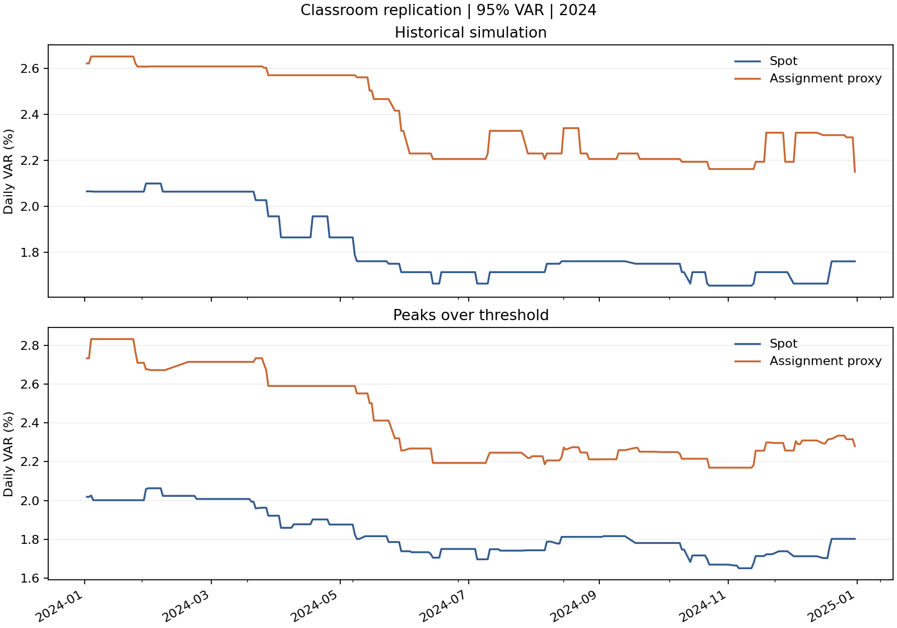
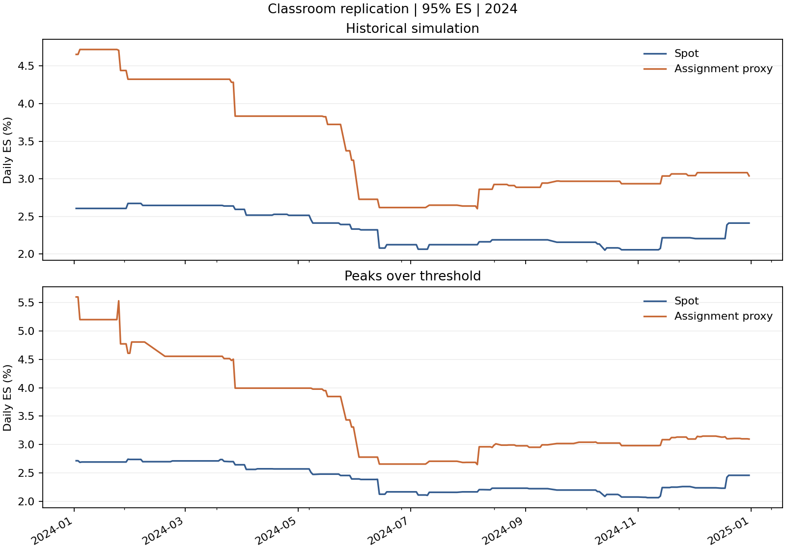
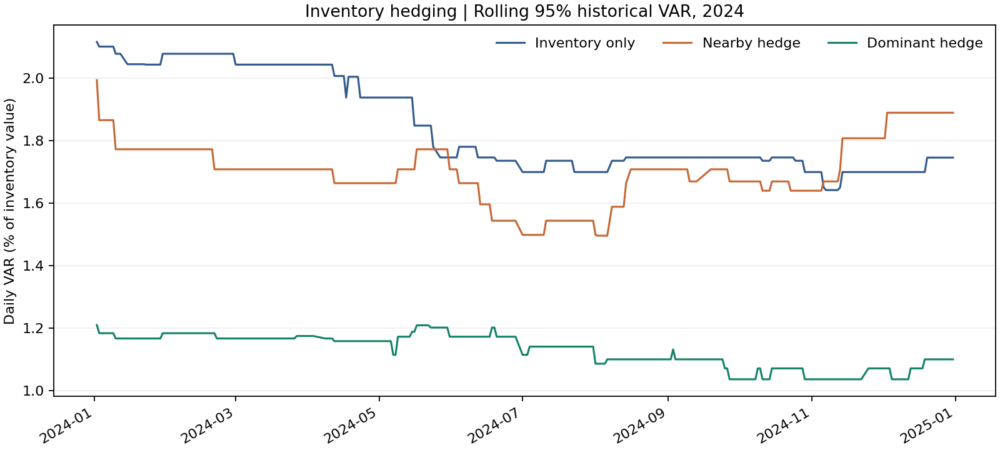
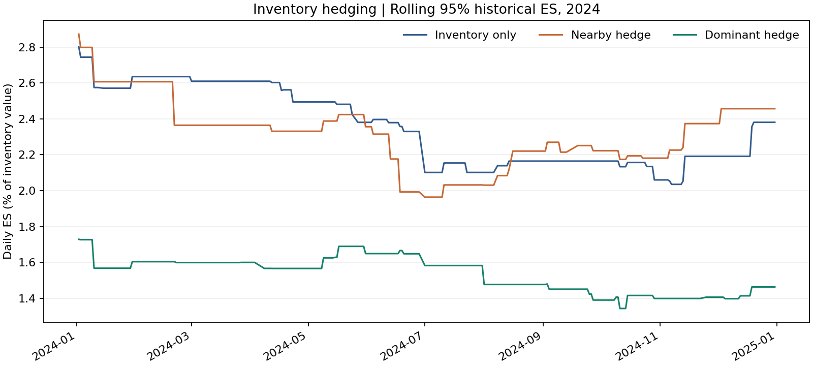

# 2024 soybean oil hedging results

[Project overview](../../README.md)

## From a classroom price series to inventory profit and loss

The original exercise considers a firm that owns soybean oil and sells an equal quantity of futures. It defines a daily price proxy as spot less the change in nearby futures, then takes log changes in that proxy. The two price levels track one another closely through the summer decline and autumn recovery.

The common spot component explains much of that visual similarity. With spot price $S_t$ and futures price $F_t$, the proxy is $P_t=S_t-\Delta F_t$. Its change is $\Delta P_t=\Delta S_t-\Delta F_t+\Delta F_{t-1}$. Yesterday’s futures move therefore enters the proxy return. A firm holding one unit of inventory and short one unit of futures earns $\Delta S_t-\Delta F_t$ today. The inventory comparison divides this amount by yesterday’s spot price.

## Risk estimates for the classroom proxy

Each estimate uses 250 preceding observations. Historical simulation takes the 95th percentile of daily losses for value at risk (VaR) and averages losses at or beyond that cutoff for expected shortfall (ES). The peaks-over-threshold model fits a generalized Pareto distribution to losses above each window’s 90th percentile, typically about 25 observations.

On 2 January, historical VaR was 2.07% for spot and 2.62% for the proxy. Historical ES was 2.61% and 4.66%, respectively. For the proxy, switching to the fitted tail model raised VaR to 2.73% and ES to 5.60%. The average loss beyond the cutoff was more sensitive to the tail model than the location of the cutoff itself. The classroom series retains nearby-contract switches, which can introduce price differences across contracts. [Price series](classroom_prices.csv) · [Rolling estimates and fitted parameters](classroom_risk.csv)

## Comparing the two inventory hedges

The inventory analysis first differences prices, then excludes the 11 dates on which either futures identifier changes. All three positions are evaluated on the same 231 dates. The dominant hedge had lower rolling VaR and ES than unhedged inventory on every evaluation date. The nearby hedge had lower VaR on 190 dates and lower ES on 121. The rolling windows overlap, and each uses historical observations preceding its evaluation date.

The annual historical ES uses a different sample: the worst 12 observations for each position across those 231 dates. The unhedged, nearby and dominant positions lost an average of 2.43%, 2.48% and 1.49% of prior inventory value on their respective tail days. [Annual estimates](risk_summary.csv) · [Rolling estimates](rolling_risk.csv) · [Tail dates by position](tail_days.csv)

### A loss on 13 November

| Per unit of inventory | Nearby hedge | Dominant hedge |
| --- | ---: | ---: |
| Spot inventory P&L | −300 | −300 |
| Short futures P&L | 0 | +288 |
| Combined P&L | −300 | −12 |
| Loss as a share of prior inventory value | 3.45% | 0.14% |

This was the nearby hedge’s worst day in the matched sample. Its futures quote was unchanged as spot fell. The dominant contract fell almost as much as spot, offsetting most of the inventory loss. The quotes establish the P&L difference; the dataset provides no explanation for the unchanged nearby quote. [Daily positions and contract identifiers](daily_audit.csv)

### Sensitivity to individual dates

Deleting one date at a time and recomputing each position’s tail membership left the dominant hedge’s ES advantage over inventory between 0.80 and 1.01 percentage points. For the nearby hedge, ES minus unhedged ES ranged from −0.05 to +0.23 points. These ranges describe the influence of a single date. The comparison covers one year of matched historical observations and excludes roll-day P&L, fees and funding costs. [Leave-one-out estimates](leave_one_out.csv)
